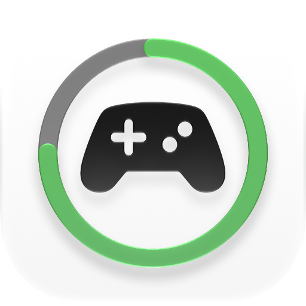
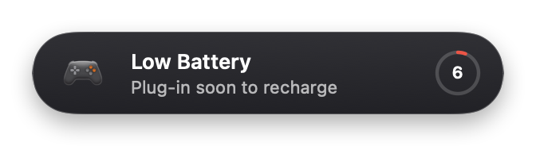
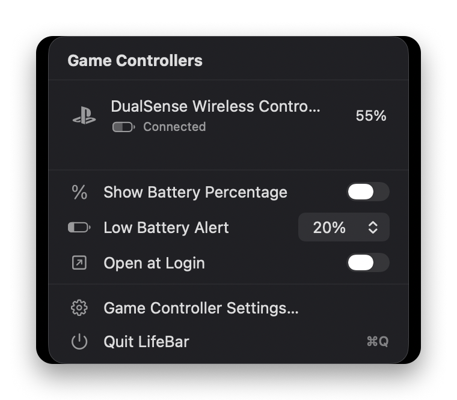

<p align="center">
  
</p>

<h1 align="center">Gamepad Battery</h1>

<p align="center">
  A lightweight macOS menu bar battery monitor and low-battery HUD for PlayStation, Xbox, Nintendo Switch, and MFi controllers.
</p>

<p align="center">
  <a href="https://github.com/passs0/GamepadBattery/releases/latest"></a>
  
  <a href="LICENSE"></a>
</p>

<p align="center">
  
  <br/><br/>
  
</p>

---

## What it does

- **Menu bar battery status:** Sits quietly in the menu bar (`LSUIElement`) with an optional live percentage readout and hover tooltip.
- **Broad controller support:** Tracks Sony (DualSense, DualShock 4), Xbox, Nintendo (Switch Pro, Joy-Con), and MFi/HID controllers via `GameController.framework`.
- **Non-activating low-battery HUD:** Shows a floating capsule alert when a controller drops below your threshold (10%–30%) without stealing focus from full-screen games.
- **Launch at Login:** Uses `SMAppService` and refreshes automatically after sleep/wake.

## Install

Download **`GamepadBattery-v1.2.2.dmg`** from [Releases](https://github.com/passs0/GamepadBattery/releases/latest) and drag `Gamepad Battery.app` to `/Applications`.

If Gatekeeper blocks the first launch:
```zsh
xattr -cr "/Applications/Gamepad Battery.app"
```

Or build from source:
```zsh
git clone https://github.com/passs0/GamepadBattery.git && cd GamepadBattery
make install
```

## Credits

Built with [Google Antigravity](https://antigravity.google) — 100% AI-written code and UI, steered and tested by hand.

## License

[MIT](LICENSE)
